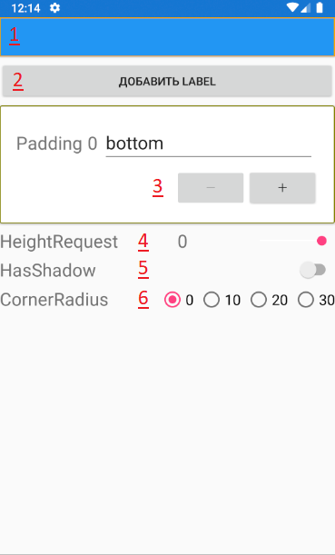
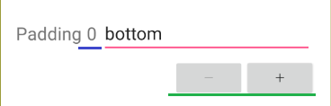
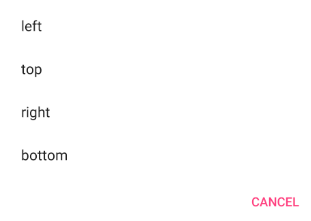

# Лабораторная работа №4. Контейнер, выбор отступа, изменение размеров и оформление

**Дисциплина:** Разработка и защита мобильных приложений  
**Источник:** `Xamarin_zadanie_4.docx` — «Xamarin 4. Компоненты Frame, picker, stepper, slider»  
**Адаптация:** Kotlin · Jetpack Compose · Material 3 · Android Emulator · существующий проект `puzzle`

## Цель

Научиться динамически добавлять содержимое контейнера, управлять отступами отдельных сторон, изменять высоту элемента, включать тень и скруглять углы в Jetpack Compose.

## Исходные макеты







Иллюстрации — ориентиры для состава элементов и расположения. Специфический Xamarin-внешний вид повторять пиксель-в-пиксель не нужно.

## Соответствие Xamarin → Compose

| Исходный элемент | Вариант на Compose | Пояснение |
|---|---|---|
| `Frame` | `Box` + `Modifier.background`/`border` + `Surface`/`shadow` | Отдельного точного аналога Xamarin Frame нет: используем контейнер с оформлением |
| `Label` | `Text` | Текст внутри контейнера |
| `Button` | Material 3 `Button` | «Добавить Label» |
| `Picker` | Material 3 `ExposedDropdownMenuBox` или `DropdownMenu` | Выбор одной из четырёх сторон |
| `Stepper` | Две кнопки `−` и `+` | В Compose нет встроенного идентичного Xamarin Stepper |
| `Slider` | Material 3 `Slider` | Изменение высоты контейнера |
| `HasShadow` | `Switch` | Включение и выключение тени |
| `CornerRadius` | `RadioButton` + число | Выбор радиуса скругления |

## Что сделать

Работу выполнить **в существующем проекте**, добавив `Lab4Screen.kt` и пункт `Laboratory 4` в общее меню. Работы №1–3, включая демонстрацию Compose/Android Views, не удалять и не ломать. Использовать один экран, без нового Android-проекта.

### 1. Контейнер Frame и кнопка добавления метки

1. Вверху разместить заметный **синий контейнер** — аналог компонента `Frame`, отмеченного на исходном рисунке цифрой 1.
2. Под ним разместить кнопку **«Добавить Label»**.
3. По нажатию **добавлять текстовую метку (`Text`) внутрь синего контейнера**. Для наглядности дать новым меткам подписи `Label 1`, `Label 2`, ... или русские аналоги. При повторных нажатиях метки действительно добавляются, а не заменяют предыдущие.
4. Продумать ограничение числа меток или прокрутку содержимого внутри контейнера, чтобы интерфейс оставался пригодным для взаимодействия; принятое решение описать в отчёте.

### 2. Picker и Stepper: отступы

5. Создать отдельную область управления отступами с текущим значением и выбором стороны. В выпадающем списке (`Picker`) должны быть **ровно исходные варианты**: `left`, `top`, `right`, `bottom`.
6. Рядом расположить кнопки `−` и `+`. Они уменьшают/увеличивают **внутренний отступ выбранной стороны синего контейнера** с фиксированным шагом (рекомендуется **4.dp**). Все четыре значения хранить независимо; при переключении стороны показывать и изменять только её значение.
7. Не позволять отступу становиться отрицательным; верхний предел выбрать и объяснить (например, 64.dp), чтобы содержимое контейнера не исчезало. Подпись должна показывать актуальные сторону и значение, например `Padding: 12 dp, bottom`.

**Неоднозначность оригинала:** исходный документ говорит об изменении «внутренних отступов компонента, помещённого на форму в предыдущем задании». В адаптации под отдельный `Lab4Screen` этой целью считается **синий контейнер `Frame` текущей лабораторной**, а не экран лабораторной №3. Такое толкование нужно явно отметить в отчёте.

### 3. Slider: высота контейнера

8. Добавить `Slider`, который изменяет **высоту синего Frame-контейнера** (аналог `HeightRequest`, как на макете).
9. Рядом выводить числовое значение высоты в `dp`. Минимум установить разумный, например **64.dp**; максимальное значение вычислять относительно **реально доступной высоты области** так, чтобы кнопка добавления метки, управление отступами, переключатели и остальные элементы оставались доступны и видимы.
10. Не принимать полную высоту устройства за свободную высоту: учитывать системные панели, заголовки и управляющие элементы; использовать измерение ограничений `BoxWithConstraints`/`onSizeChanged` или аналогичный способ. Не использовать `verticalScroll` как единственное средство обойти недостаток места — требование заключается в реальном ограничении высоты.
11. При изменении ориентации устройства или размера окна корректно ограничивать текущую высоту новой верхней границей. Если измерение даёт мало пространства, сохранить доступность остальных элементов и документировать поведение на небольших экранах.

### 4. Тень и скругление

12. Добавить `Switch` с подписью **`HasShadow`**. При включении синему контейнеру должна назначаться видимая тень (например, `Modifier.shadow(elevation = 8.dp, shape = ...)`), при выключении — исчезать.
13. Добавить группу радиокнопок (`RadioButton`) с подписью **`CornerRadius`** и вариантами **`0`, `10`, `20`, `30`** (в `dp`, как радиус округления).
14. При изменении выбранного варианта менять скругление **именно синего контейнера**. Использовать одинаковую форму для клиппинга фона, границы и тени, чтобы они визуально совпадали.

## Требования к реализации

- Использовать Kotlin и Jetpack Compose. Хранить состояния через `rememberSaveable` там, где это оправдано: список добавленных меток/их количество, четыре отступа, выбранная сторона, высота, тень и радиус.
- Не менять непосредственно свойства Android View: текст и оформление должны вычисляться из Compose-state.
- Рекомендуется вынести модель отступов в четыре значения или отдельный тип состояния, не смешивая их.
- Сохранить существующие Gradle/Kotlin/SDK версии, если не возникнет объективной необходимости их изменять.
- Кнопка `Back` должна возвращать в общее меню.

## Сценарий самопроверки

1. Открыть `Laboratory 4`: видны синий контейнер и все органы управления.
2. Дважды нажать «Добавить Label»: в контейнере теперь **две** метки.
3. Выбрать `left`, нажать `+` дважды: меняется только левый внутренний отступ.
4. Выбрать `bottom`, нажать `+`, затем `−`: изменяется только нижний отступ, его значение отображается в подписи.
5. Сдвинуть `Slider`: высота контейнера меняется, при максимуме остальные элементы остаются доступны.
6. Включить и выключить `HasShadow`: тень появляется и исчезает.
7. Выбрать радиусы `0`, `10`, `20`, `30`: скругление заметно изменяется.
8. Повернуть эмулятор: размер контейнера ограничен новой доступной высотой, интерфейс не ломается.
9. Вернуться в меню и открыть лабораторные №1–3: их функциональность сохранена.

## Критерии приёмки

- [ ] Синий контейнер создан на Compose.
- [ ] Кнопка добавляет метки внутрь контейнера.
- [ ] Picker содержит `left/top/right/bottom`.
- [ ] Кнопки `−`/`+` меняют выбранный внутренний отступ и обновляют числовую подпись.
- [ ] Четыре отступа независимы и не становятся отрицательными.
- [ ] Slider меняет высоту контейнера, не скрывая остальные элементы.
- [ ] HasShadow переключает тень.
- [ ] CornerRadius изменяет скругление между `0/10/20/30`.
- [ ] Проект собирается и работает в Android Emulator.
- [ ] Первая–третья лабораторные доступны и не сломаны.

## Отчёт

Создать `TIMP_Android_Labs/lab_04_report.md`: цель, оригинальная постановка и её интерпретация, соответствие Xamarin/Compose, структура и основные состояния, числовые шаги и диапазоны, способ вычисления максимальной высоты, фрагменты Kotlin-кода и скриншоты **начального экрана**, **добавленных меток**, **изменения отступа**, **максимальной высоты**, **тени** и **скругления**.

## Сборка

```bash
cd ~/AndroidStudioProjects/puzzle
./gradlew clean assembleDebug
adb devices
./gradlew installDebug
```
