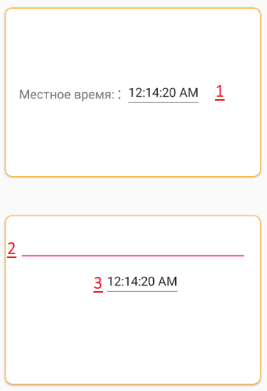

# Лабораторная работа №5. Текущее время и выбор часового пояса

**Источник:** `Лаба5.docx`. **Внимание:** в заголовке исходного файла написано «Xamarin 6. Компоненты TimePicker, Picker», однако по имени файла и последовательности курса эта работа оформлена как **№5**.  
**Адаптация:** Kotlin · Jetpack Compose · Android SDK · существующий проект `puzzle`.

## Цель

Показать локальное время устройства и текущее время выбранного часового пояса. Изучить работу со временем, часовыми поясами, выбором из списка и обновлением интерфейса без блокировки UI-потока.

## Исходный макет



На макете: **1** — текущее время устройства; **2** — выбор часового пояса; **3** — текущее время в выбранном часовом поясе.

## Соответствие Xamarin → Compose

| Xamarin | Реализация на Compose |
|---|---|
| `TimePicker` (местное текущее время) | Стилизованный **только для чтения** индикатор времени (`Text` в `OutlinedCard`/`Surface`), опционально `TimePicker` Material 3 только для демонстрации компонента |
| `Picker` часовых зон | `ExposedDropdownMenuBox`/`DropdownMenu` с названиями зон |
| `TimePicker` (время выбранной зоны) | Второй **только для чтения** индикатор времени в похожем оформлении |

**Важное отличие:** стандартный диалог `TimePicker` служит для **выбора пользователем времени**, а исходное задание требует **показывать текущее время** двух зон. Поэтому в основной реализации используем стилизованные read-only компоненты, не позволяющие менять часы вручную. Это функционально соответствует задаче, хотя не является буквальным Xamarin TimePicker. Если преподаватель требует показать именно визуальный Material 3 `TimePicker`, можно добавить его как **необязательный демонстрационный компонент**, но он не должен подменять настоящее текущее время.

## Задание

1. В уже существующем проекте создать `Lab5Screen.kt`, добавить пункт `Laboratory 5` в главное меню; сохранить лабораторные №1–4.
2. Сделать **два визуальных блока**, по возможности близких по расположению к исходному макету.
3. **Блок 1:** отображать **текущее местное время Android-устройства** с подписью `Местное время` (часовой пояс именно устройства/эмулятора, а не ПК разработчика).
4. **Блок 2:** разместить `Picker` (раскрывающийся список) для выбора **часового пояса**, а под ним — **текущее время выбранной зоны**.
5. После смены зоны время в блоке 2 должно пересчитываться **для одного и того же текущего момента времени**, а не путём ручного сложения часов и не как фиксированное значение.
6. Оба времени должны **обновляться автоматически каждую секунду**, без нажатий и без `Thread.sleep` в главном потоке. Для обновления можно использовать `LaunchedEffect` с `delay(1_000)` и `Instant.now()`/эквивалент.
7. Необходимо корректно учитывать **переходы на летнее/зимнее время** и сдвиги часовых зон. Использовать идентификаторы IANA (`Europe/Amsterdam`, `Europe/Moscow`, `Asia/Tokyo` и т. п.), а не фиксированные `UTC+3`.
8. Для выбора предусмотреть понятный список из нескольких реальных часовых поясов, **либо полный список `ZoneId.getAvailableZoneIds()`** с поиском/прокруткой. Выбранную стратегию и конкретный список описать в отчёте. Минимально предложить: `UTC`, `Europe/Amsterdam`, `Europe/Moscow`, `Asia/Tokyo`, `America/New_York`, `Asia/Dubai`.
9. Явно показывать название выбранной зоны и время с секундами, например `HH:mm:ss` в 24-часовом формате, чтобы переход можно было легко продемонстрировать.
10. Сохранить выбранную часовую зону через `rememberSaveable`, корректно обрабатывать изменение системной часовой зоны и перезапуск экрана.

## Техническое уточнение о времени и Android API

В проекте исходно `minSdk = 24`. API `java.time` доступен штатно на новых Android; для работы с `java.time` на более старых версиях Android, которые поддерживает приложение, нужно **core library desugaring** либо другой совместимый API. Если используется `java.time`, проверить настройку desugaring и не менять минимальную версию Android ради лабораторной. Альтернатива — совместимые `java.util.TimeZone`/`Calendar`/`SimpleDateFormat` с корректной обработкой зон; при любом выборе использовать один текущий момент времени для обоих дисплеев.

Не следует подменять `ZoneId` простой суммой часов: смещения меняются из-за переходов времени и исторических правил. Обязательно описать принятое API в отчёте.

## Сценарий проверки

1. Открыть `Laboratory 5`: отображается местное время устройства.
2. Проверить, что оба индикатора меняют секунды без пользовательских действий.
3. Выбрать `UTC`, затем `Europe/Moscow`, `Asia/Tokyo`, `America/New_York`: индикатор второго блока показывает соответствующее текущее время.
4. Убедиться, что местное время в первом блоке **не меняется** при выборе другой зоны.
5. Сверить для одной и той же даты время разных зон с надёжным справочником; не сравнивать только часы, игнорируя возможный переход суток.
6. Свернуть и вернуть приложение: обновление продолжается корректно, несколько параллельных таймеров не создаётся.
7. Повернуть экран: выбранный часовой пояс сохраняется.
8. Проверить возврат в главное меню, остальные лабораторные доступны.

## Критерии приёмки

- [ ] Есть два блока времени в соответствии с исходным макетом.
- [ ] Первый блок отображает системное локальное время Android.
- [ ] Есть выбор реальных часовых поясов через Compose Picker-аналог.
- [ ] Второй блок показывает **текущее** время выбранной зоны.
- [ ] Время обновляется автоматически, с секундами.
- [ ] Переходы часовых поясов рассчитываются через корректные timezone-правила.
- [ ] Интерфейс не блокируется таймером.
- [ ] Выбор зоны сохраняется при пересоздании.
- [ ] Проект собирается и запускается в эмуляторе.

## Отчёт

Создать `TIMP_Android_Labs/lab_05_report.md`: описание экрана, выбранный способ представления `TimePicker` в Compose, перечень часовых зон и используемый API времени, устройство обновления раз в секунду, обработку летнего/зимнего времени, версии инструментов и скриншоты **местного времени** и **двух разных выбранных зон**. Зафиксировать, что оригинальное имя файла — `Лаба5.docx`, но заголовок в документе содержит «Xamarin 6».

## Сборка

```bash
cd ~/AndroidStudioProjects/puzzle
./gradlew clean assembleDebug
adb devices
./gradlew installDebug
```
