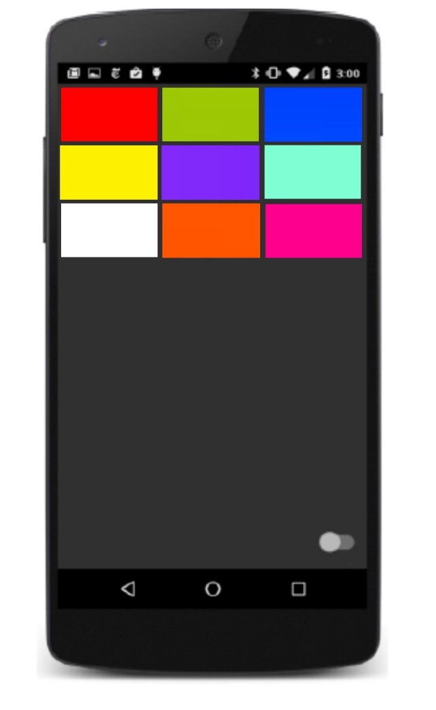
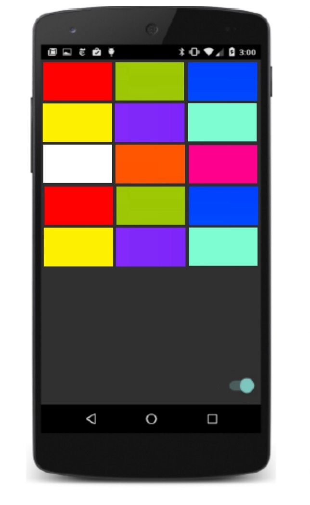

# Лабораторная работа №6. Цветная сетка, Switch и заполнение по таймеру

**Источник:** `Лаба6.docx` — «Xamarin 6. Компоненты Grid, Switch».  
**Адаптация:** Kotlin · Jetpack Compose · Material 3 · Coroutines · Android Emulator · проект `puzzle`.

## Цель

Создать цветную сетку с тремя равными столбцами; реализовать автоматическое добавление цветных ячеек по одной в секунду, контроль вместимости экрана и автоматический сброс в начальное состояние.

## Исходный макет





Сохранять смысл макета: цветная сетка начинается сверху, управляющий Switch расположен **в правом нижнем углу**. Повторять вид системных панелей старой Android-версии не нужно.

## Соответствие Xamarin → Compose

| Исходный Xamarin | Реализация Compose |
|---|---|
| `Grid` с 3 столбцами | `Column` из `Row` с тремя ячейками; либо подходящий grid-контейнер Compose |
| Цветной прямоугольник | `Box` с `Modifier.background(color)` |
| `Switch` | Material 3 `Switch` |
| Периодический таймер | `LaunchedEffect` + `delay(1_000)` |
| Добавление строки | Изменение количества ячеек в Compose-state |

## Исходные цвета и порядок

Начальная сетка имеет **3 строки × 3 столбца**, всего девять ячеек одинаковой ширины/пропорционального размера:

| Колонка 1 | Колонка 2 | Колонка 3 |
|---|---|---|
| Красный | Зелёный | Синий |
| Жёлтый | Фиолетовый | Аквамарин |
| Белый | Оранжевый | Розовый |

Далее новые ячейки добавляются циклически в **том же порядке**: красный → зелёный → синий → жёлтый → фиолетовый → аквамарин → белый → оранжевый → розовый → красный ...

Для однозначности цветов использовать, например, `Color.Red`, `Color.Green`, `Color.Blue`, `Color.Yellow`, `Color(0xFF800080)` (фиолетовый), `Color(0xFF7FFFD4)` (аквамарин), `Color.White`, `Color(0xFFFFA500)` (оранжевый), `Color(0xFFFF69B4)` (розовый). Конкретные оттенки можно слегка подстроить под исходную иллюстрацию; порядок должен остаться неизменным.

## Задание

1. В существующем проекте создать экран `Lab6Screen.kt`, добавить вход в него из меню. Не изменять лабораторные №1–5.
2. Создать начальную цветную сетку **3×3**. Ячейки трёх колонок должны быть равной ширины, а строки — одинаковой выбранной высоты. Желательно сохранить видимые тонкие зазоры/границы, особенно для белой ячейки.
3. В правом нижнем углу экрана разместить `Switch` с понятной подписью, например `Автозаполнение`. Switch должен оставаться доступен независимо от числа строк.
4. При ручном переводе `Switch` в **On** начать автоматически добавлять **одну новую цветную ячейку раз в 1000 мс**. Ячейки добавляются слева направо: сначала три заполняют четвёртую строку, следующие три — пятую и т. д. Не добавлять сразу всю строку за один тик.
5. Новые цвета выбирать циклически из заданного списка девяти цветов. После розового снова идёт красный.
6. Перевод `Switch` в **Off** вручную должен **останавливать дальнейшее заполнение**. В исходном тексте явно задан автоматический сброс только **при заполнении экрана**, а не при ручном выключении. Поэтому в адаптации после ручного выключения уже добавленные ячейки **остаются**, а повторное включение продолжает с текущего места; описать это решение в отчёте.
7. При достижении предельного числа **полных строк, помещающихся в доступную высоту**, приложение должно автоматически перевести `Switch` в **Off** и **сбросить сетку к исходным 3×3**. Это соответствует пункту 3 оригинала.
8. Максимальное число полных строк вычислять от **реально доступной области сетки**, не от общей высоты физического дисплея. Учитывать системные панели, нижнюю область с Switch, отступы, высоту строки, межстрочные зазоры и изменение ориентации.
9. Не допускать появления частично скрытой новой строки. Для контроля вместимости использовать измерение `BoxWithConstraints`/`onSizeChanged` и согласованное ограничение; **не использовать вертикальную прокрутку как способ бесконечно добавлять строки**. При смене ориентации проверять новую вместимость и безопасно возвращаться к исходному состоянию, если сетка больше не помещается.
10. При достижении предела сбрасывать сетку **в тот же момент, когда завершается заполнение последней допустимой строки**. Поскольку требование формулирует «при заполнении ... Switch автоматически переходит в позицию выкл и возвращает Grid в начальное положение», не удерживать заполненный экран бесконечно. Для удобства демонстрации можно кратко показать уведомление `Экран заполнен: сброс` без задержки главного потока.
11. Использовать `rememberSaveable` для количества добавленных элементов и состояния Switch, `LaunchedEffect` + `delay(1_000)` для таймера. При выключении, уходе экрана из композиции или смене ключа отменять корутину; не допускать параллельных таймеров.
12. При уходе Activity в фон приостанавливать автоматическое добавление или выключать автоматический режим. Выбранную политику написать в отчёте; рекомендуется пауза на `ON_STOP`, продолжение на `ON_START`, как в лабораторной №3.

## Важные уточнения исходного задания

- В исходном тексте «добавляется по одному цвету в строку» уточняется рисунком и последовательностью цветов: **на каждом тике добавляется одна ячейка**, строки заполняются слева направо.
- «До заполнения всего экранного пространства» в Compose понимается как **до последней полной строки в доступной области сетки**, а не до закрытия управляющего Switch.
- На очень маленьком экране, где начальная сетка 3×3 физически не помещается вместе с органами управления, отображать минимально возможный вариант без краша и пояснить ограничения; начальную сетку не удалять произвольно.
- Если при повороте меняется количество допустимых строк, не оставлять старую сетку за пределами видимой области.

## Сценарий проверки

1. Открыть `Laboratory 6`: видна сетка 3×3 в заданном порядке цветов, Switch выключен и находится справа внизу.
2. Включить Switch: через ~1 с появляется одна красная ячейка в новой строке; ещё через ~1 с — зелёная; затем синяя.
3. Убедиться, что каждая следующая ячейка появляется по одной, а не по три сразу.
4. Выключить Switch вручную: добавление останавливается, предыдущие ячейки остаются.
5. Включить снова: продолжить заполнение без пропуска цветов и параллельных таймеров.
6. Дождаться заполнения последней полностью помещающейся строки: Switch автоматически выключается, сетка возвращается к 3×3.
7. Свернуть приложение во время заполнения: фоновая работа соответствует заявленной политике.
8. Проверить поворот устройства: элементы не выходят из доступной области, Switch доступен.
9. Вернуться в главное меню и убедиться, что лабораторные №1–5 работают.

## Критерии приёмки

- [ ] Изначально показано девять ячеек в сетке 3×3, правильный порядок цветов.
- [ ] Сетка состоит из трёх одинаковых по ширине столбцов.
- [ ] Управляющий Switch находится справа внизу.
- [ ] При включении каждые ~1000 мс добавляется **одна** ячейка в указанном цикле цветов.
- [ ] Сетка растёт строками сверху вниз; незаконченная текущая строка допускается только в процессе заполнения.
- [ ] Ручное выключение останавливает таймер; повторное включение продолжает.
- [ ] При заполнении доступной высоты Switch выключается автоматически и начальная сетка восстанавливается.
- [ ] Высота рассчитана по доступному пространству, не скрывает нижний Switch.
- [ ] Параллельные таймеры не возникают; UI-поток не блокируется.
- [ ] Проект собирается и работает на эмуляторе.

## Отчёт

Создать `TIMP_Android_Labs/lab_06_report.md`: исходная и адаптированная постановка, реализация трёх колонок, таблица цветов, выбор высоты ячейки и расчёт `maxRows`, алгоритм следующего цвета, применение `LaunchedEffect`, остановка/сброс и работа жизненного цикла. Добавить скриншоты **3×3**, **частично заполненной новой строки**, **нескольких новых строк** и **состояния после автоматического сброса**. Указать, что исходный документ — `Лаба6.docx`.

## Сборка

```bash
cd ~/AndroidStudioProjects/puzzle
./gradlew clean assembleDebug
adb devices
./gradlew installDebug
```
