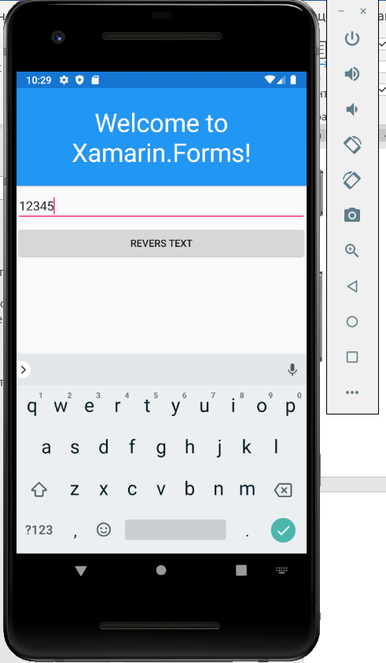
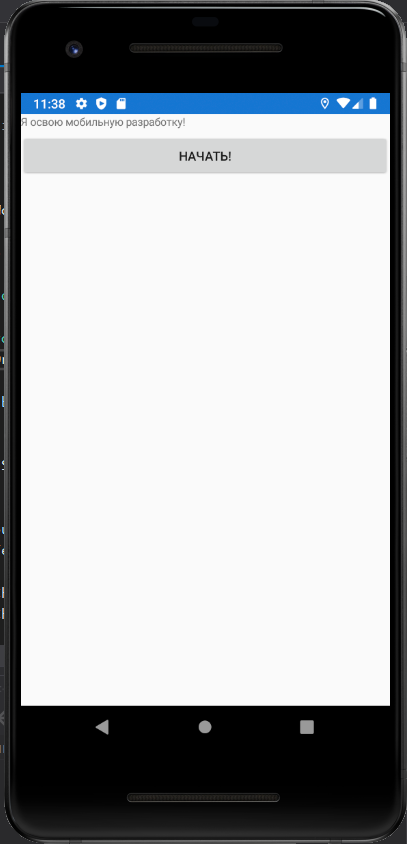

# Лабораторная работа №1
## Первое приложение на Kotlin: интерфейс, эмулятор и жизненный цикл

**Дисциплина:** Разработка и защита мобильных приложений  
**Проект:** существующий Android-проект `puzzle`  
**Стек:** Ubuntu · VS Code · Kotlin · Jetpack Compose · Android SDK · Gradle · Android Emulator

### Цель

Изучить структуру Android-проекта, запуск приложения на эмуляторе и физическом устройстве, базовые компоненты Jetpack Compose, обработку ввода и жизненный цикл `Activity`.

### Что меняется относительно задания Xamarin.Forms

| Исходное задание | Вариант для текущего проекта |
|---|---|
| Создать `Xamarin.Forms` solution и project | Разобраться с уже созданным `puzzle`: корень Gradle-проекта и модуль `:app` |
| Пустое приложение Xamarin.Forms | Использовать существующий шаблон Android с `MainActivity` и Compose |
| Добавить UWP | Объяснить, почему нативный Android-проект не имеет UWP-target; повторять UWP не требуется |
| Эмуляторы Android и iOS | Запустить Android Emulator; об ограничении iOS написать в отчёте |
| `ContentPage` / `SecondPage` на C# | Создать второй экран `SecondScreen` на Kotlin с `@Composable` |
| Вёрстка Xamarin.Forms | Вёрстка на Compose (`Column`, `Row`, `Text`, `TextField`, `Button`) |

> **Согласование с преподавателем:** пункты про запуск UWP и iOS нельзя дословно выполнить в нативном Android-стеке. В рамках этой адаптации требуется Android-эмулятор и, по возможности, физическое Android-устройство.

### Исходные макеты

Основной экран из исходной лабораторной:



Пример второго экрана из исходной лабораторной:



Изображения — ориентиры по содержимому и расположению элементов; не нужно копировать специфический внешний вид Xamarin.Forms пиксель-в-пиксель.

## Задание

### Часть 1. Исследование проекта и среды

1. Открыть в VS Code существующий проект `~/AndroidStudioProjects/puzzle`. **Новый проект не создавать.**
2. Найти и описать назначение следующих файлов: `MainActivity.kt`, `AndroidManifest.xml`, `app/build.gradle.kts`, корневого `build.gradle.kts`, `settings.gradle.kts`, `gradlew`.
3. Ответить: чем **Gradle-проект** отличается от его **модуля `:app`**? Как это соотносится с понятиями «решение» и «проект» из Xamarin/Visual Studio?
4. Ответить: что означала галочка «поместить решение и проект в одном каталоге» в исходном задании и почему у Android/Gradle другая организация?
5. Указать фактические версии Android Gradle Plugin, Kotlin, Gradle и JDK, используемые **в текущем проекте**. Не менять версии без необходимости.

Полезные команды:

```bash
cd ~/AndroidStudioProjects/puzzle
./gradlew --version
cat gradle/libs.versions.toml
```

### Часть 2. Android Emulator

6. Запустить существующее виртуальное Android-устройство (AVD) средствами Android Studio или из терминала VS Code.
7. Проверить подключение через `adb` и установить debug-сборку приложения.
8. Изучить конфигурацию AVD и пояснить параметры из исходного задания: `hw.battery`, `hw.camera.back`, `hw.cpu.ncore`, `hw.gps`, `hw.gpu.mode`, `hw.ramSize`, `hw.sdCard`, `sdcard.size`, `vm.heapSize`.

   Для каждого параметра указать **его назначение** и **примеры допустимых значений или диапазонов** применительно к вашей версии эмулятора. Отметить, что параметры старых AVD могут отличаться от нынешнего интерфейса Device Manager и системных образов.

9. Кратко сравнить Intel HAXM и KVM: что это такое и почему на Ubuntu используется KVM (если аппаратное ускорение доступно).
10. Запустить приложение на физическом Android-устройстве с включённой отладкой по USB **или**, если устройства нет, описать порядок подготовки телефона, подключения ADB и запуска приложения.
11. Показать, как изменить **отображаемое имя приложения** в Android (ресурс `app_name`, настройки Manifest/label). Имя проекта/папки при этом можно не менять.

Команды проверки:

```bash
emulator -list-avds
adb devices
./gradlew assembleDebug
./gradlew installDebug
```

### Часть 3. Первый экран

12. Сверстать **первый экран** по исходному макету: заголовки/подписи, поле ввода, кнопка `Reverse Text` и другие элементы, показанные на иллюстрации. Использовать Jetpack Compose; выбор точных отступов и цветовой схемы — на усмотрение студента.
13. Кнопка **Reverse Text** должна менять содержимое поля ввода на обратный порядок символов. Пример: `Android` → `diordnA`. Повторное нажатие должно возвращать исходный порядок для этой строки.
14. Состояние текстового поля должно быть управляемым Compose (`rememberSaveable` предпочтителен для обычного пользовательского ввода). Проверить корректность работы с пустой строкой и русским текстом.

Подходящие компоненты: `Text`, `OutlinedTextField`/`TextField`, `Button`, `Column`, `Spacer`.

### Часть 4. Второй экран и жизненный цикл

15. Добавить Kotlin-файл `SecondScreen.kt` с отдельной `@Composable`-функцией, создающей второй интерфейс **из кода на Kotlin** (аналог `SecondPage`, ранее создававшейся на C#). Состав элементов взять с исходной иллюстрации.
16. Реализовать показ второго экрана **при возвращении приложения из фонового состояния**. Важное уточнение: простое пересоздание composable или поворот экрана не должно ошибочно считаться возвращением из фона.
17. Определить подходящий сигнал жизненного цикла (`Activity.onRestart` или наблюдение за жизненным циклом приложения) и объяснить выбранное решение. При первом запуске приложение должно показывать первый экран.
18. Проверить сценарий: открыть первый экран → свернуть приложение кнопкой Home → вернуться из списка приложений → должен появиться второй экран.

> Не требуется создавать отдельную `Activity` на каждый экран: второй экран допустимо реализовать как composable с переключением состояния. Если выбраны две Activity, это нужно описать в отчёте.

## Критерии приёмки

- [ ] Проект `puzzle` собирается командой `./gradlew assembleDebug`.
- [ ] Приложение установлено и запускается на Android Emulator.
- [ ] Есть первый экран с вводом и кнопкой `Reverse Text`.
- [ ] Текст разворачивается корректно, в том числе после повторного нажатия.
- [ ] Есть второй экран, оформленный по заданному образцу.
- [ ] При возвращении из фона отображается второй экран; при первоначальном запуске — первый.
- [ ] Получены ответы на теоретические вопросы об устройстве проекта и AVD.
- [ ] Объяснены отличия от исходных требований UWP/iOS.

## Отчёт

Включить: цель, стек и версии инструментов, описание файлов проекта, ответы на вопросы, скриншоты основного и второго экрана, последовательность проверки перехода из фона, фрагменты собственного Kotlin-кода и вывод о результате.

**Источник:** «Задание 1. Создание первого проекта Xamarin.Forms», адаптировано под существующий Android-проект.
