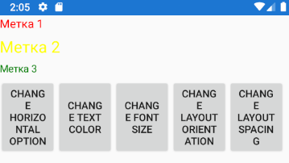
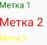
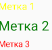
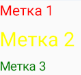
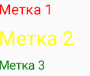

# Лабораторная работа №2
## Управление текстовыми элементами, кнопками и компоновкой в Jetpack Compose

**Дисциплина:** Разработка и защита мобильных приложений  
**Проект:** `puzzle` · экран `Lab2Screen`  
**Стек:** Kotlin · Jetpack Compose · Material 3 · VS Code · Android Emulator

### Цель

Научиться изменять свойства элементов пользовательского интерфейса по нажатию кнопок, управлять состоянием Compose и динамически перестраивать расположение элементов.

### Соответствие элементов

| Xamarin.Forms | Jetpack Compose |
|---|---|
| `Label` | `Text` |
| `Button` | `Button` |
| `HorizontalOptions` | `Alignment` / `Modifier.align(...)` / `Arrangement` |
| `TextColor` | `Text(color = ...)` |
| `FontSize` | `Text(fontSize = ...sp)` |
| `StackLayout.Orientation` | `Column` / `Row` |
| `Spacing` | `Arrangement.spacedBy(...)` / `Spacer` |
| `IsEnabled` (кнопки) | `Button(enabled = ...)` |

### Исходные иллюстрации

Общий макет (три метки и пять кнопок):



Пример последовательности горизонтального расположения:


Пример смены цвета:




Примеры смены ориентации и интервалов приведены ниже.

## Задание

1. Внутри существующего проекта `puzzle` создать экран `Lab2Screen.kt` (или отдельную функцию `Lab2Screen()` в подходящем файле). **Не создавать новый Android-проект.**
2. Разместить **три текстовые метки** («Метка 1», «Метка 2», «Метка 3») и **пять кнопок** с надписями из оригинала:
   - `Change Horizontal Option`
   - `Change Text Color`
   - `Change Font Size`
   - `Change Layout Orientation`
   - `Change Layout Spacing`
3. Для исходного состояния принять горизонтальное расположение метки 1 **слева**, а все метки разместить в одной выбранной ориентации (например, вертикально). Начальные цвета текста задать **красный, зелёный и жёлтый** по порядку. Конкретные начальные размеры шрифта и отступы выбрать самостоятельно и записать в отчёте.

### Задача 1. Изменение горизонтального положения

При каждом нажатии `Change Horizontal Option` метка **«Метка 1»** циклически перемещается:

```text
Слева → По центру → Справа → Слева → ...
```

Перемещение должно быть видно при достаточной ширине контейнера. Остальные метки не должны неожиданно менять собственное выравнивание.

### Задача 2. Смена цветов

При нажатии `Change Text Color` **каждая метка** переходит к следующему цвету в цикле:

```text
Красный → Зелёный → Жёлтый → Красный → ...
```

Если начальные цвета меток — красный, зелёный и жёлтый, после первого нажатия они должны стать соответственно зелёным, жёлтым и красным.

Дополнительные иллюстрации:



### Задача 3. Увеличение шрифта

По нажатию `Change Font Size` размер шрифта **всех трёх меток увеличивается** на выбранный шаг (например, `2.sp`).

Правила:

- У каждой метки должен быть **собственный максимальный размер** (допускаются разные пределы).
- Если метка достигла максимума, её шрифт дальше не увеличивается.
- Остальные метки могут продолжать увеличиваться, пока не достигнут своих пределов.
- Когда **все три** метки достигли своих максимумов, кнопка становится неактивной (`enabled = false`).
- Ни одна метка не должна превысить установленный максимум.

Значения начальных размеров, максимумов и шага нужно указать в отчёте: оригинал не фиксирует их численно.

### Задача 4. Изменение ориентации

По нажатию `Change Layout Orientation` три метки должны переключаться между **вертикальным** и **горизонтальным** расположением.




В Compose допустимо реализовать выбор между `Column` и `Row` по булевому состоянию. Кнопки должны оставаться доступными после переключения.

### Задача 5. Увеличение расстояния между метками

По нажатию `Change Layout Spacing` расстояние **между тремя метками** должно последовательно и пропорционально увеличиваться. Например: `8.dp → 16.dp → 24.dp → ...`.

Не путать интервалы между метками с отступами между кнопками. Поведение должно работать и при вертикальной, и при горизонтальной ориентации, насколько позволяет ширина экрана.

При очень больших интервалах допускается зафиксировать верхний предел или использовать прокрутку, но это поведение необходимо описать в отчёте. В исходном документе предел не задан.

## Технические требования

- Использовать Kotlin и Jetpack Compose, без Xamarin.Forms, C# и XML-разметки для основного UI.
- Хранить изменяемые значения в Compose-state (`remember` / `rememberSaveable`).
- Не изменять напрямую UI-объекты, как это делалось в некоторых Xamarin-примерах: UI должен строиться из актуального состояния.
- Убедиться, что все пять функций работают **на одном и том же экране** и не сбрасывают друг друга без причины.
- Проверить работоспособность на запущенном Android Emulator.

## Запуск и проверка

```bash
cd ~/AndroidStudioProjects/puzzle
./gradlew assembleDebug
adb devices
./gradlew installDebug
```

Откройте экран лабораторной через выбранный способ навигации в `puzzle`. Если общего меню пока нет, допустимо временно отображать `Lab2Screen()` из `MainActivity.setContent { ... }`.

## Критерии приёмки

- [ ] На экране три метки и пять кнопок.
- [ ] Первая кнопка циклически переключает левое, центральное и правое положение первой метки.
- [ ] Вторая кнопка циклически меняет цвета **всех** меток.
- [ ] Третья кнопка увеличивает размер шрифта с индивидуальными ограничениями и отключается после достижения всех максимумов.
- [ ] Четвёртая кнопка переключает `Column` ↔ `Row`.
- [ ] Пятая кнопка увеличивает интервалы между метками.
- [ ] Изменения корректно сочетаются: например, после смены ориентации работают кнопки цвета и размера.
- [ ] Проект собирается и запускается в эмуляторе.

## Отчёт

Приложить скриншоты исходного состояния и результатов работы пяти кнопок, перечислить выбранные размеры/шаги/ограничения, описать хранение состояния Compose и показать основные фрагменты написанного кода.

**Источник:** «Задание 2. Компоненты Label и Button». Поведение элементов сохранено, элементы Xamarin.Forms заменены их Compose-аналогами.
