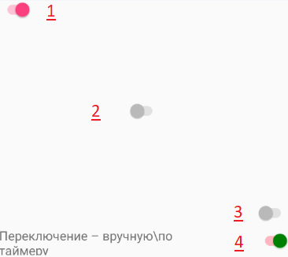

# Лабораторная работа №3
## Переключатели Switch и автоматическое переключение по таймеру

**Дисциплина:** Разработка и защита мобильных приложений  
**Проект:** `puzzle` · экран `Lab3Screen`  
**Стек:** Kotlin · Jetpack Compose · Kotlin Coroutines · Android Emulator

### Цель

Освоить обработку изменений состояния переключателей, управление доступностью элементов и периодические действия без блокировки главного UI-потока.

### Макет исходного задания



В оригинале элементы **1, 2, 3, 4** относятся к Xamarin.Forms `Switch`. В этой работе им соответствуют `Switch` из Compose.

## Задание

1. В существующем проекте `puzzle` создать экран `Lab3Screen.kt` с четырьмя переключателями `Switch` и подписями `1`, `2`, `3`, `4` (или понятными текстовыми названиями).
2. Переключатели **1–3** образуют кольцевую последовательность:

```text
1 → 2 → 3 → 1 → ...
```

3. В каждый момент времени в ручном режиме должен быть **один активный шаг** последовательности. Когда пользователь переводит доступный переключатель в состояние `On`:
   - текущий шаг становится неактивным для взаимодействия (`enabled = false`);
   - его отображаемое состояние переводится в `Off` (`checked = false`);
   - следующий по номеру шаг становится доступным и включённым (`checked = true`, `enabled = true`);
   - после третьего переключателя очередь возвращается к первому.

   **Уточнение адаптации:** исходный текст использует свойства Xamarin `IsToggled` и `IsEnabled` и не до конца уточняет исходные значения всех переключателей. Для проверяемого поведения принять в начале **шаг 1 активным**, а шаги 2–3 — недоступными. Выбранную интерпретацию показать на демонстрации и описать в отчёте. При реализации допустимо хранить один индекс активного шага, вычисляя `checked` и `enabled` из него, а не поддерживать шесть несогласованных флагов.

4. **Четвёртый Switch** управляет автоматическим режимом:
   - `Off`: последовательность переключается только действиями пользователя;
   - `On`: каждые **1000 мс (1 секунда)** автоматически выполняется переход `1 → 2 → 3 → 1`;
   - выключение четвёртого Switch немедленно прекращает дальнейшие автоматические переходы;
   - повторное включение продолжает цикл с текущего шага, не создавая второго параллельного таймера.
5. Во время автоматического режима ручное управление шагами 1–3 можно отключить во избежание конкурирующих событий. Это уточнение реализации необходимо обозначить в отчёте.
6. Таймер реализовать **без `Thread.sleep()` в UI-потоке**: рекомендуется `LaunchedEffect` + `delay(1000)` из Kotlin Coroutines.
7. Проверить, что при уходе приложения в фон автоматический цикл не продолжает выполнять бесконтрольную работу. Допустимые варианты: приостанавливать цикл на `ON_STOP` либо останавливать автоматический режим; зафиксировать выбранное поведение в отчёте.

### Подсказка по состоянию (не готовое решение)

Подумайте, какие данные нужны экрану:

| Состояние | Назначение |
|---|---|
| `activeIndex` | Текущий шаг: 0, 1 или 2 |
| `autoMode` | Включён ли автоматический режим |
| `checked` каждого `Switch` | Вычисляется из `activeIndex` |
| `enabled` каждого `Switch` | Вычисляется из `activeIndex` и `autoMode` |

Логика следующего шага выражается формулой `(activeIndex + 1) % 3`. Состояния Compose следует создавать через `remember` или `rememberSaveable` в зависимости от выбранного поведения при пересоздании экрана.

### Самопроверка сценариев

| Действие | Ожидаемое поведение |
|---|---|
| Первый запуск | Активен шаг 1 |
| Ручное действие на шаге 1 | Активируется шаг 2 |
| Ручное действие на шаге 2 | Активируется шаг 3 |
| Ручное действие на шаге 3 | Активируется шаг 1 |
| Включить Switch 4 | Примерно раз в секунду сменяется текущий шаг |
| Выключить Switch 4 | Автоматические переходы прекращаются |
| Снова включить Switch 4 | Цикл продолжается с текущего шага |

> Возможны небольшие отклонения фактического интервала из-за планирования задач операционной системой; `delay(1000)` не гарантирует точный таймер реального времени.

## Запуск

```bash
cd ~/AndroidStudioProjects/puzzle
./gradlew assembleDebug
adb devices
./gradlew installDebug
```

Если меню лабораторных пока не реализовано, допустимо временно вызвать `Lab3Screen()` в `setContent` главной Activity.

## Критерии приёмки

- [ ] На экране отображаются четыре переключателя.
- [ ] Первые три образуют цикл `1 → 2 → 3 → 1`.
- [ ] Неактивные переключатели нельзя использовать вне очереди.
- [ ] Четвёртый переключатель включает автоматическую смену с интервалом около одной секунды.
- [ ] При его выключении автоматическая смена прекращается.
- [ ] Повторные включения не создают несколько одновременно работающих таймеров.
- [ ] Интерфейс остаётся отзывчивым, главный поток не блокируется.
- [ ] Определено и проверено поведение при уходе приложения в фон.
- [ ] Проект собирается и работает на Android Emulator.

## Отчёт

Приложить скриншоты исходного состояния, ручного переключения и автоматического режима; описать схему состояний, работу `LaunchedEffect`/coroutines, отмену таймера и поведение жизненного цикла. Указать принятую интерпретацию свойств `IsToggled` / `IsEnabled` исходного задания.

**Источник:** «Задание 3. Switch и таймер». Сохранены кольцевое переключение, четвёртый управляющий Switch и интервал 1 секунда; поведение уточнено для Compose.
